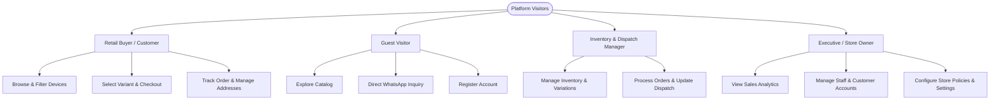
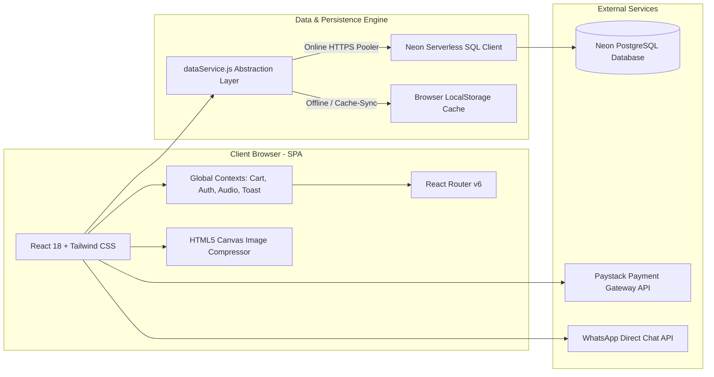
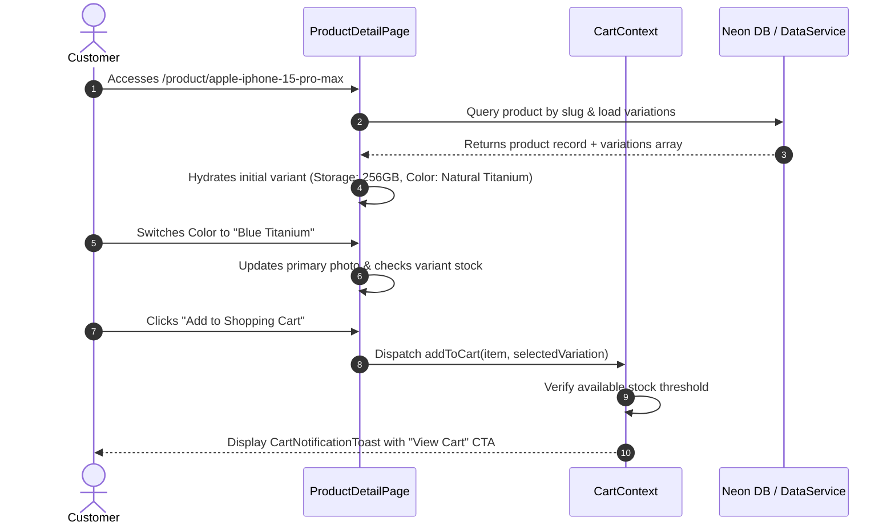
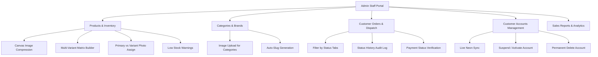
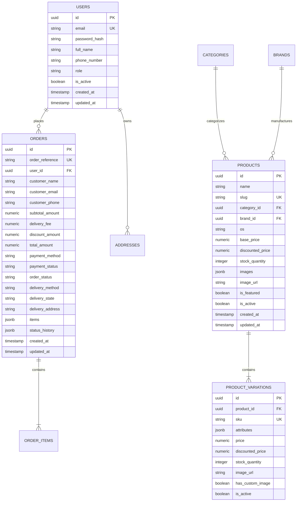

# UBAN HARKALLA — Product Requirements Document (PRD)

| **Document Version** | 1.0.0 |
|---|---|
| **Status** | Approved / Living Document |
| **Product Name** | UBAN HARKALLA E-Commerce Platform |
| **Target Audience** | Retail Customers, Wholesalers, Store Operations Staff, System Administrators |
| **Primary Region** | Kano State, Nigeria (Headquarters) & Nationwide Delivery |
| **Architecture** | React 18 (Vite) + Neon Serverless PostgreSQL + Resilient Offline-First Local Storage |

---

## 1. Executive Summary & Vision

### 1.1 Product Vision
**UBAN HARKALLA** is a specialized, high-trust digital storefront and inventory management engine for premium smartphones (Apple iPhones, flagship Androids), electronics, smart gadgets, and authentic accessories. 

Based in the commercial district of Kano, Nigeria, the platform delivers an omnichannel retail experience: combining rapid local same-day delivery, nationwide courier fulfillment, flexible payment mechanisms (Paystack online card/transfer payments and manual direct bank transfer verification), and an interactive Web Audio brand identity.

### 1.2 Core Value Propositions
1. **Guaranteed Authenticity**: Explicit condition grading (Brand New Sealed, UK Used Grade A) with detailed specs, battery health visibility, and warranty terms.
2. **Dynamic Product Variation Matrix**: Granular variant configuration by storage capacity (128GB, 256GB, 512GB, 1TB), color options, and condition with independent pricing, stock control, and customized photos.
3. **Frictionless Logistics**: Free localized delivery within Kano metropolis and transparent regional shipping rates across Nigerian states with real-time shipment status tracking.
4. **Dual-Mode Architectural Resilience**: Powered by **Neon Serverless PostgreSQL** for live cloud database synchronization with an automatic, lossless fallback to encrypted local storage ensuring continuous availability even during network disruptions.
5. **Full Administrative Authority**: An integrated executive portal with real-time inventory counts, customer lifecycle control (suspend/activate/delete), order status audit logging, and canvas-based local image compression for high-speed uploads.

---

## 2. User Personas & Core Journeys

### 2.1 Persona Definitions

#### Persona 1: Retail Smartphone Buyer (e.g., Abubakar in Kano)
- **Goal**: Browse authentic iPhones, inspect specific condition and colorway, order with local free delivery, and track order to doorstep.
- **Pain Point**: Skepticism regarding counterfeit gadgets, delayed delivery, complicated checkouts.

#### Persona 2: Nationwide Buyer (e.g., Chidi in Abuja/Lagos)
- **Goal**: Order specific UK-used flagship smartphone with verified battery health, pay securely via Paystack, receive nationwide tracking number.
- **Pain Point**: Lack of variant-level photos, delivery uncertainty.

#### Persona 3: Store Operations / Inventory Manager
- **Goal**: Add new device shipments, configure variations (colors, storages), upload optimized photos directly from smartphone/PC, update dispatch status.
- **Pain Point**: Cumbersome image upload pipelines, complex database administration.

#### Persona 4: Super Administrator / Store Owner
- **Goal**: Monitor daily revenue, review customers, toggle account access for security, review low-stock alerts, export sales reports.

---

## 3. System Architecture & Technical Stack

### 3.1 Technology Stack Details
- **Frontend Framework**: React 18.3+ with Vite fast-refresh bundling.
- **Routing**: `react-router-dom` v6 with splat routes and history preservation.
- **Styling**: Tailwind CSS with custom glassmorphic dark-mode palette (`slate-950`, `emerald-500`, `amber-500`).
- **Icons**: Lucide React.
- **Database**: **Neon Serverless PostgreSQL** via `@neondatabase/serverless` over secure HTTPS with transaction-safe pooling.
- **Payment Processing**: Paystack Inline JS API for verified debit/credit cards, USSD, and bank transfers.
- **Audio Branding**: Native HTML5 Web Audio API and AudioContext with persistent mute/playback preference.
- **Image Optimization**: Client-side Canvas 2D image scaling and JPEG/WebP compression (`imageUpload.js`).

---

## 4. Detailed Functional Specifications

### 4.1 Public Storefront & Catalog

#### 4.1.1 Navigation & Brand Header
- **Top Announcement Bar**: Displays free Kano delivery notices, active phone hotline, WhatsApp hotline, operational hours (Mon-Sat 9AM-7PM), and brand audio playback controller.
- **Main Navigation**: Brand logo, universal search bar, route links (Home, Shop, About, Contact, Cart), and dynamic Auth pill (Sign In / Account Name).
- **Sticky Mobile Bar**: Bottom navigation for quick-access to Home, Shop, Cart (with live badge counter), and Profile.

#### 4.1.2 Homepage Discovery
- **Hero Slider**: Promotional banners showcasing current deals, new arrivals, and brand messaging.
- **Category Matrix**: Quick-links to major categories (Apple iPhones, Android Smartphones, Smart Gadgets & Audio, Power & Accessories).
- **Featured Deals Carousel**: Curated list of high-priority devices with instant discount badges and stock indicators.
- **Trust Highlights**: Genuine verification guarantees, WhatsApp support, store pickup assurances.
- **Customer Testimonials**: Carousel of verified customer feedback with ratings and city indicators.

#### 4.1.3 Advanced Catalog Filtering (`/shop`)
- **Multidimensional Filters**:
  - **Category**: Tabbed / radio navigation.
  - **Operating System**: iOS, Android, Universal.
  - **Condition**: Brand New (Sealed), UK Used (Grade A), Refurbished.
  - **Price Range**: Dual-bound price filter (Min Price to Max Price).
  - **Search**: Real-time keyword filter matching product name, model, brand, description, and variation SKU.
  - **Sorting**: Newest Arrivals, Price: Low to High, Price: High to Low, Featured First.

---

### 4.2 Product Detail Engine (`/product/:slug`)

- **Interactive Gallery**:
  - Primary high-resolution preview with zoom on hover.
  - Thumbnail reel supporting dynamic switching.
  - Automatic variant photo switching: selecting a variation with a custom photo immediately focuses that image in the gallery.
- **Dynamic Variant Matrix**:
  - Attribute selectors for Storage, Color, and Condition.
  - Real-time stock status computation (e.g. "Only 3 units left in stock!").
  - Dynamic price display (showing original price strikethrough if discounted).
- **Direct Engagement**:
  - WhatsApp Direct Inquiry button pre-populating message with device name and variation specs.
  - Add to Shopping Cart button with atomic stock validation.
  - Sticky mobile Add to Cart bar visible upon scrolling past fold.

---

### 4.3 Shopping Cart & State (`/cart`)

- **Cart Management**:
  - Item listing displaying product thumbnail, title, selected variation breakdown, unit price, quantity spinner, and line subtotal.
  - Quantity controls with hard ceiling at available stock.
  - Single-click line item removal and "Clear Entire Cart" action.
- **Financial Calculations**:
  - Subtotal computation.
  - Free Kano delivery qualification tracker (progress bar towards free shipping threshold).
  - Estimated delivery fee selection.
  - Total payable calculation in Nigerian Naira (₦).
- **Toast Feedback**:
  - Glassmorphic slide-in notification toast (`CartNotificationToast`) triggered whenever items are added or modified, featuring direct "View Cart" shortcut.

---

### 4.4 Checkout & Order Processing (`/checkout`)

- **Customer Information**:
  - Full Name, Email Address, Nigerian Phone Number (080..., 081..., 090..., 070..., 091...).
  - Delivery Method: Home / Office Courier Delivery vs Store Self-Pickup.
  - Address Fields: State dropdown, City, Detailed Street Address, Delivery Instructions.
- **Payment Gateways**:
  1. **Paystack Online Checkout**:
     - Seamless card, bank transfer, and USSD integration.
     - Webhook/callback verification with automatic transition to `payment_status: 'verified'` and `order_status: 'Confirmed'`.
  2. **Direct Bank Transfer**:
     - Displays UBAN HARKALLA verified corporate bank account details (Bank Name, Account Name, Account Number).
     - Provides clear instruction for transfer with order reference as payment narration.
     - Order placed with `payment_status: 'pending'` awaiting manual admin audit.
- **Atomic Stock Decrement**:
  - Validates stock immediately prior to order confirmation.
  - Atomically decrements product and variation stock counts upon order creation.
  - Generates unique reference code (format: `UBH-YYYY-XXXXX`).

---

### 4.5 Customer Account & Dashboard (`/dashboard/*`)

- **Overview (`/dashboard`)**:
  - Summary cards: Total Purchases, Pending Shipments, Completed Orders.
  - Recent order tracking widgets with real-time status badges.
- **Orders History (`/dashboard/orders`)**:
  - Filter by order status (All, Pending, Confirmed, Processing, Out for Delivery, Delivered, Cancelled).
  - Search by order reference code or product title.
  - Detailed Order View (`/dashboard/orders/:id`) showing step-by-step dispatch timeline, delivery agent notes, itemized breakdown, and printable invoice.
- **Address Book (`/dashboard/addresses`)**:
  - Multi-address storage (Home, Office, Alternate).
  - Set default shipping address for accelerated one-click checkout.
- **Profile Settings (`/dashboard/profile`)**:
  - Update personal information, phone number, and password.

---

### 4.6 Administrative Core (`/admin/*`)

#### 4.6.1 Product & Variation Administration
- **Image Processing**:
  - Multi-file drag & drop or file picker.
  - Local client-side canvas scaling (`imageUpload.js`): automatic resizing to max 900px width/height and JPEG compression to under 150KB.
  - Re-ordering and single-click primary product photo selection.
  - Custom variation photo assignment with reset-to-primary functionality.
- **Variant Matrix Management**:
  - Add/remove variations dynamically.
  - Per-variant SKU, attribute specification (Storage, Color, Condition), price overrides, and stock quantities.
  - Global stock sum calculated from variant matrix.
- **Admin Feedback**:
  - Slide-in `AdminToastProvider` notifications for all updates, uploads, deletions, and publishing toggles.

#### 4.6.2 Category & Brand Management
- **Category Controls**:
  - Category creation and editing with local image upload.
  - Automated URL slug generation.
  - Safeguard preventing category deletion if active products are linked.

#### 4.6.3 Order Fulfillment & Dispatch
- **Status Filter Tabs**:
  - All Orders, Pending, Confirmed, Processing, Out for Delivery, Delivered, Cancelled.
- **Dispatch Audit Trail**:
  - Real-time status update with mandatory staff note and timestamped entry into `status_history`.
  - Manual payment verification for direct bank transfer orders.

#### 4.6.4 Customer Account Governance
- **Direct Neon Synchronization**:
  - Real-time customer list querying Neon's `users` table joined with order spending aggregations.
  - Automatic purging of mock/dummy records.
- **Access Controls**:
  - Single-click account suspension: sets `is_active = false` in Neon database, immediately preventing subsequent logins.
  - Single-click account activation: restores customer access.
  - Permanent account deletion with confirmation modal.

---

## 5. Data Models & Entity Schema

### 5.1 Entity Relationship Diagram

---

## 6. Business Rules & Validation Constraints

1. **Pricing and Currency**:
   - Currency symbol is Nigerian Naira (`₦`).
   - All monetary calculations must round to two decimal places; frontend formats with thousands commas (e.g. `₦1,580,000`).
   - `discounted_price` must strictly be less than `base_price` when set.
2. **Stock Invariants**:
   - Stock cannot be negative.
   - Total product stock equals the arithmetic sum of its variation quantities when variations exist.
   - Out-of-stock items disable checkout actions and display clear "Out of Stock" notices.
3. **Delivery Rules**:
   - Local Kano Metropolis orders qualify for free delivery when subtotal meets store threshold or via standard Kano routing.
   - Nationwide shipping rates vary by state zone (Northern, Central, Southern Nigeria).
4. **Account Security**:
   - Passwords must be at least 6 characters long.
   - Suspended accounts (`is_active = false`) are rejected at login with an explicit suspension notification.
   - Super admin accounts cannot be suspended or deleted by lower-tier admins.
5. **Image Processing Standards**:
   - Uploaded photos must be standard image MIME types (`image/jpeg`, `image/png`, `image/webp`).
   - File size ceiling: canvas compression downsamples files to `< 150KB` and max dimension of `900px`.

---

## 7. Non-Functional Requirements (NFRs)

### 7.1 Performance
- First Contentful Paint (FCP) under 1.5 seconds on standard 3G/4G Nigerian mobile connections.
- Time to Interactive (TTI) under 2.5 seconds.
- Production build chunking using Vite Rollup code splitting.

### 7.2 Resilience & Offline Handling
- Seamless dual-mode architecture:
  - If Neon database is reachable, query cloud PostgreSQL directly.
  - If network drops or database latency spikes, automatically fallback to local storage cache without displaying fatal white-screen errors.
  - Automatically sync newly registered offline records upon reconnection.

### 7.3 Security
- Parameterized SQL queries via Neon serverless tagged templates to prevent SQL injection.
- Role-based route authorization guards for `/admin/*` and `/dashboard/*`.
- Client-side input sanitation preventing Cross-Site Scripting (XSS).

### 7.4 Cross-Device & Responsive Design
- 100% responsive across mobile viewports (iPhone SE, iPhone 14/15 Pro Max, Samsung Galaxy, Pixel), tablets (iPad, Galaxy Tab), and desktops (1080p, 2K, 4K).
- Touch-friendly tap targets of at least 44x44px.
