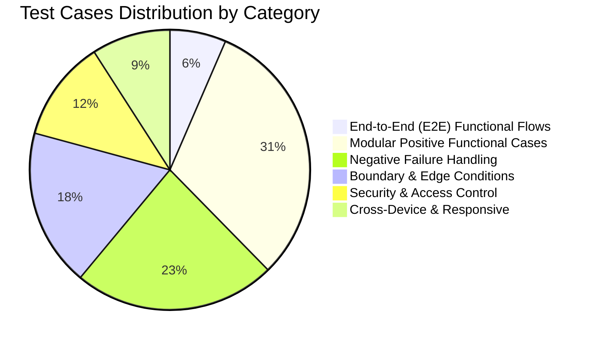

# UBAN HARKALLA — Comprehensive QA Test Cases Specification

| **Document Version** | 1.0.0 |
|---|---|
| **Author** | Antigravity QA Engineering Team |
| **Project** | UBAN HARKALLA Premium Smartphones & Gadgets E-Commerce |
| **Scope** | End-to-End Functional, Negative, Boundary, Edge, Security, and Cross-Device Verification |
| **Test Matrix Priority Levels** | **P0** (Blocker/Critical) • **P1** (High) • **P2** (Medium/Low) |

---

## Summary Matrix

---

## Master Section: End-to-End (E2E) Functional User Journey Test Suite

The following **10 master end-to-end test cases** validate complete cross-page, multi-role user workflows spanning storefront discovery, client-side state engines, cloud database synchronization, administrative fulfillment, and financial payment handling.

### **E2E-TC-001: Guest Customer Discovery to Online Payment & Order Confirmation Flow**
- **Flow**: Public Storefront → Multi-Filter Search → Dynamic Variation Selection → Shopping Cart → Paystack Checkout → Success Receipt & Stock Decrement
- **User Persona**: Guest Retail Buyer (Abubakar in Kano)
- **Priority**: **P0 (Critical / Blocker)**
- **Pre-Conditions**: Device has network access; customer is not logged in; iPhone 15 Pro Max has stock >= 5 units.
- **Detailed Step-by-Step E2E Execution**:
  1. Open `http://localhost:3000/`.
  2. Type `"iPhone 15"` in the header search input and press Enter.
  3. On `/shop`, filter by Condition: `"Brand New (Sealed)"` and Category: `"Apple iPhones"`.
  4. Click on the product card for `"Apple iPhone 15 Pro Max"`.
  5. On `/product/apple-iphone-15-pro-max`, select Storage: `"256GB"` and Color: `"Natural Titanium"`.
  6. Verify the price reflects ₦1,580,000 and the gallery highlights the Natural Titanium device image.
  7. Click `"Add to Shopping Cart"`.
  8. Verify `CartNotificationToast` slides in at the top right showing: *"✓ Added to Cart: Apple iPhone 15 Pro Max"*; click `"View Cart"`.
  9. On `/cart`, verify line total is ₦1,580,000. Inspect the free delivery progress bar indicating free Kano delivery qualification.
  10. Click `"Proceed to Checkout"`.
  11. On `/checkout`, input:
      - Full Name: `Abubakar Garba`
      - Email: `abubakar.garba.test@gmail.com`
      - Phone: `08031234567`
      - Delivery Method: `Home / Office Delivery`
      - State: `Kano`
      - City: `Kano Metropolis`
      - Street Address: `Plot 18 Zoo Road, Near Gidan Dan Hausa`
  12. Select Payment Method: `"Paystack (Debit Card / Bank Transfer)"`.
  13. Click `"Place Order & Pay with Paystack"`.
  14. In the Paystack inline popup modal, complete the test transaction (using test success card `4084 0840 0000 4084`).
- **Expected End-to-End Result**:
  - Paystack webhook/callback succeeds immediately.
  - User is redirected to `/checkout/success`.
  - Unique Order Reference is generated (e.g. `UBH-2026-XXXXX`).
  - Order is inserted into Neon database `orders` table with `payment_status: 'verified'` and `order_status: 'Confirmed'`.
  - Cart counter resets to 0 and local cart cache is cleared.
  - Return to `/product/apple-iphone-15-pro-max` and verify stock decremented by exactly 1 unit.

---

### **E2E-TC-002: Customer Sign Up, Address Book Setup, Bank Transfer Checkout & Dashboard Tracking**
- **Flow**: New Customer Registration → Brand Audio Welcome → Address Book Management → Catalog Selection → Direct Bank Transfer Checkout → Order Tracking Timeline in Customer Dashboard
- **User Persona**: Registered Customer (Fatima in Abuja)
- **Priority**: **P0 (Critical / Blocker)**
- **Pre-Conditions**: Clean browser session; email `fatima.test.abuja@gmail.com` is not yet registered.
- **Detailed Step-by-Step E2E Execution**:
  1. Navigate to `/signup`.
  2. Complete form:
     - Full Name: `Fatima Aliyu`
     - Email: `fatima.test.abuja@gmail.com`
     - Phone: `08129876543`
     - Password: `Password123!`
     - Confirm Password: `Password123!`
  3. Click `"Create Account"`.
  4. Verify system authenticates account, stores session in `localStorage`, plays audio welcome chime, and redirects to `/dashboard`.
  5. In customer sidebar, click `"Addresses"` (`/dashboard/addresses`).
  6. Click `"Add New Address"`, input:
     - Label: `Home`
     - Recipient Name: `Fatima Aliyu`
     - Phone: `08129876543`
     - State: `Abuja (FCT)`
     - City: `Wuse 2`
     - Street: `45 Aminu Kano Crescent`
     - Check: `Set as default address`
  7. Click `"Save Address"`. Address card appears with `"Default"` badge.
  8. Click `"Shop"` in top navigation.
  9. Add `"Samsung Galaxy S24 Ultra 5G"` (512GB, Titanium Gray) to cart and proceed to `/checkout`.
  10. Observe address fields auto-fill from saved default address.
  11. Select Payment Method: `"Direct Bank Transfer"`.
  12. Click `"Place Order"`.
  13. Verify `/checkout/success` displays UBAN HARKALLA corporate bank accounts (Zenith Bank / Stanbic IBTC) with payment instructions.
  14. Click `"View My Orders"` navigating to `/dashboard/orders`.
  15. Click on the newly placed order.
- **Expected End-to-End Result**:
  - Order appears in Customer Dashboard with status `"Pending"` and payment status `"pending"`.
  - Progress tracker displays milestone 1 active (`Pending: Awaiting Bank Transfer verification`).
  - Invoice and order summary match exact purchased variant specs and delivery address.

---

### **E2E-TC-003: Admin Inventory Creation to Storefront Cold-Start Propagation Flow**
- **Flow**: Admin Portal Login → Image Upload with Canvas Scaling → Primary Photo Selection → Variant Matrix Builder → Cloud Neon DB Sync → Private/Cold-Start Visitor Verification
- **User Persona**: Store Inventory Manager & New Store Visitor
- **Priority**: **P0 (Critical / Blocker)**
- **Pre-Conditions**: Admin credentials `admin@ubanharkalla.com` / `admin123`.
- **Detailed Step-by-Step E2E Execution**:
  1. Navigate to `/admin/login`. Log in with super admin credentials.
  2. Navigate to `/admin/products/create`.
  3. Input Product Details:
     - Product Name: `"Google Pixel 9 Pro Fold"`
     - Base Price: `2100000`
     - Discounted Price: `1980000`
     - Category: `Android Smartphones`
     - Operating System: `Android`
     - Short Description: `"Next-gen foldable with Google Tensor G4 and dual displays."`
  4. Drag and drop 3 high-resolution sample photos (each > 3MB).
  5. Verify `imageUpload.js` canvas engine scales photos to max 900px and under 150KB. Success toast displays: *"Processed and added 3 image(s) successfully!"*
  6. Hover over Image #2 and click `"Make Primary"`. Verify primary badge moves to Image #2.
  7. In Variations section, configure:
     - Variant 1: Storage: `256GB`, Color: `Obsidian`, Stock: `5`, Price: `1980000`.
     - Variant 2: Storage: `512GB`, Color: `Porcelain`, Stock: `3`, Price: `2200000`, with custom photo upload.
  8. Click `"Save Product"`. Verify green toast: *"Product 'Google Pixel 9 Pro Fold' created successfully!"* Redirects to `/admin/products`.
  9. Open a fresh Incognito / Private browser window (completely empty `localStorage` simulating a first-time user).
  10. Open `http://localhost:3000/`.
  11. Check Featured / New Arrivals on homepage.
  12. Navigate to `/shop` and search `"Pixel 9 Pro Fold"`.
  13. Click the product card and inspect the product details page.
- **Expected End-to-End Result**:
  - The newly created product immediately appears for first-time visitors directly querying Neon database.
  - Image #2 displays as the main preview photo.
  - Switching to `"Porcelain"` variant immediately swaps to the custom uploaded porcelain photo.
  - Prices and stock levels match the admin configuration perfectly.

---

### **E2E-TC-004: End-to-End Order Dispatch, Fulfillment & Audit Log Lifecycle**
- **Flow**: Order Placement → Admin Order Ingestion → Status Filter Tab Navigation → Payment Verification → Dispatch Status Progression → Customer Live Timeline Sync
- **User Persona**: Customer (Buyer) & Store Fulfillment Dispatcher (Admin)
- **Priority**: **P0 (Critical / Blocker)**
- **Pre-Conditions**: An order exists in `Pending` status placed via Direct Bank Transfer.
- **Detailed Step-by-Step E2E Execution**:
  1. Admin logs into staff portal and navigates to `/admin/orders`.
  2. Click on the `"Pending"` filter tab.
  3. Verify the target order is listed with orange `"Pending"` badge.
  4. Click on the order to open `/admin/orders/:id`.
  5. Under Payment Information, click `"Verify Bank Payment"`.
  6. Enter confirmation note: *"Payment verified against Zenith Bank credit alert Ref #ZEN-9921"* and submit.
  7. Verify payment status updates to `"verified"` and order status transitions to `"Confirmed"`.
  8. Under Dispatch Controls, select New Status: `"Processing"`, add note: *"Device packaged in tamper-evident box, IMEI #3567881234 recorded"*, and click `"Update Status"`.
  9. Advance status to `"Out for Delivery"`, add note: *"Dispatched with Kano express dispatch rider (Aliyu - 08035551234)"*.
  10. Advance status to `"Delivered"`, add note: *"Package handed to customer at Zoo Road premises; OTP signature verified"*.
  11. Open customer session in another tab and navigate to `/dashboard/orders/:id`.
- **Expected End-to-End Result**:
  - Admin audit trail (`status_history`) logs every milestone transition with staff name, timestamp, and note.
  - Customer order timeline shows all 5 milestones completed in green with exact courier notes.
  - Customer receives order delivery notification in dashboard notification center.

---

### **E2E-TC-005: Customer Account Lifecycle, Security & Suspension Governance Flow**
- **Flow**: Customer Registration → Admin Directory Ingestion → Account Suspension → Login Rejection Enforcement → Account Reactivation → Permanent Purge
- **User Persona**: New Customer & Super Administrator
- **Priority**: **P0 (Critical / Blocker)**
- **Pre-Conditions**: Admin logged in on `/admin/customers`.
- **Detailed Step-by-Step E2E Execution**:
  1. In a private browser window, go to `/signup` and register:
     - Name: `Ibrahim Shehu`
     - Email: `ibrahim.shehu.security@test.com`
     - Phone: `08091122334`
     - Password: `SecretPassword123`
  2. Once signed up, return to admin tab on `/admin/customers`.
  3. Refresh or observe live table: verify `Ibrahim Shehu` appears in row with `Active` green badge.
  4. Click `"Suspend"` button on Ibrahim's row.
  5. Verify status badge changes to `"Suspended"` in red. Toast displays: *"Suspended customer account 'Ibrahim Shehu'."*
  6. In customer browser window, log out and navigate to `/login`.
  7. Attempt logging in as `ibrahim.shehu.security@test.com` with `SecretPassword123`.
  8. Verify login fails with error message: *"Your customer account has been suspended. Please contact customer support."*
  9. In admin window, click `"Activate"` button on Ibrahim's row. Status returns to `"Active"`.
  10. In customer window, retry login with same credentials. Login succeeds and opens `/dashboard`.
  11. In admin window, click the trash icon on Ibrahim's row. Modal prompts: *"Delete Customer Account"*. Click `"Yes, Delete"`.
- **Expected End-to-End Result**:
  - `is_active` updates reliably in the live Neon `users` table upon suspension and reactivation.
  - Suspended accounts are rejected at the authentication gateway.
  - Customer deletion purges the record from both Neon DB and local storage cache; customer can no longer log in.

---

### **E2E-TC-006: Atomic Inventory Depletion, Sold-Out Safeguard & Restoration Flow**
- **Flow**: Last Unit Inventory Setup → User A Checkout → Stock Becomes Zero → User B Storefront Lockout → Admin Order Cancellation → Automatic Stock Restoration
- **User Persona**: Customer A, Customer B, and Store Admin
- **Priority**: **P0 (Critical / Blocker)**
- **Pre-Conditions**: A product variant (e.g. AirPods Pro 2) has `stock_quantity = 1`.
- **Detailed Step-by-Step E2E Execution**:
  1. Customer A opens `/product/apple-airpods-pro-2-usb-c` in Browser Window A.
  2. Customer B opens `/product/apple-airpods-pro-2-usb-c` in Browser Window B.
  3. Customer A clicks `"Add to Shopping Cart"`, navigates to `/checkout`, and completes checkout via Paystack.
  4. Verify Customer A's order succeeds; stock in database decrements from 1 to 0.
  5. Customer B refreshes Window B.
  6. Observe: stock badge displays `"Out of Stock"` in red.
  7. Verify `"Add to Shopping Cart"` button is disabled with text `"Sold Out"`.
  8. Attempting to force an add-to-cart or checkout via script is rejected with: *"Product is no longer available in stock"*.
  9. Admin opens `/admin/orders`, finds Customer A's order, and selects `"Cancel Order"` with note: *"Customer cancelled before packaging"*.
  10. Customer B refreshes Window B.
- **Expected End-to-End Result**:
  - Stock decrements atomically without race conditions.
  - Zero-stock products are locked from further purchase.
  - Cancelling an order automatically restores the 1 unit back to inventory; Add to Cart button re-enables for Customer B.

---

### **E2E-TC-007: Category & Brand Lifecycle to Storefront Discovery Flow**
- **Flow**: Admin Category Creation → Product Association → Storefront Filter Population → Customer Filtering → Linked Product Deletion Safeguard
- **User Persona**: Admin Operations & Storefront Shopper
- **Priority**: **P1 (High)**
- **Pre-Conditions**: Admin logged in.
- **Detailed Step-by-Step E2E Execution**:
  1. Navigate to `/admin/categories`.
  2. Click `"Add New Category"`.
  3. Enter Category Name: `"Gaming Consoles & Gear"`.
  4. Upload a category banner photo. Click Save. Toast confirms creation.
  5. Navigate to `/admin/products/create`.
  6. Create product `"PlayStation 5 Slim 1TB"` and select Category: `"Gaming Consoles & Gear"`. Save product.
  7. Open public storefront `/` in a new tab.
  8. Navigate to `/shop`. Observe `"Gaming Consoles & Gear"` appears in Category filter options.
  9. Click `"Gaming Consoles & Gear"` filter tab. Only the PS5 product appears.
  10. Return to `/admin/categories` and attempt deleting `"Gaming Consoles & Gear"`.
- **Expected End-to-End Result**:
  - New category propagates from admin to public catalog filters seamlessly.
  - Attempting to delete a category that has active assigned products is blocked by a safety guard: *"Cannot delete category with active products. Reassign or delete products first."*

---

### **E2E-TC-008: Direct WhatsApp Sales Inquiry & Support Handoff Flow**
- **Flow**: Product Inspection → WhatsApp CTA Click → Message Parameterization → Handoff to Official Business Hotline
- **User Persona**: Mobile Shopper Seeking Device Verification
- **Priority**: **P1 (High)**
- **Pre-Conditions**: On `/product/apple-iphone-14-pro`.
- **Detailed Step-by-Step E2E Execution**:
  1. Open `/product/apple-iphone-14-pro`.
  2. Select Variant: Storage: `"256GB"`, Color: `"Deep Purple"`, Condition: `"UK Used (Grade A)"`.
  3. Inspect battery health disclosure (`98% Battery Health`).
  4. Click `"Order via WhatsApp"` button.
  5. Inspect the generated URL target.
- **Expected End-to-End Result**:
  - Browser opens WhatsApp endpoint: `https://wa.me/2348123456789?text=...`.
  - The URL-encoded message body contains:
    - Store greeting: *"Hello UBAN HARKALLA"*
    - Device title: *"Apple iPhone 14 Pro"*
    - Selected specifications: *"Storage: 256GB | Color: Deep Purple | Condition: UK Used (Grade A)"*
    - Listed price: *"₦1,250,000"*
    - Inquiry prompt: *"Is this device currently available for same-day delivery in Kano?"*

---

### **E2E-TC-009: Offline-to-Online Network Resilience & Seamless Sync Flow**
- **Flow**: Online Cart Building → Sudden Network Disconnection → Offline Cart Mutation & Navigation → Reconnection → Lossless Database Resynchronization
- **User Persona**: Shopper on Unstable Mobile Network
- **Priority**: **P0 (Critical / Blocker)**
- **Pre-Conditions**: User on `/shop` with online network.
- **Detailed Step-by-Step E2E Execution**:
  1. Add 2 items to cart while online.
  2. In Chrome DevTools Network panel, set throttling to `"Offline"`.
  3. Navigate to `/cart`.
  4. Increment quantity of Item 1 from 1 to 2.
  5. Navigate to `/about` and then back to `/cart`.
  6. Observe: cart items, updated quantities, and subtotal calculations remain intact via local storage engine without white-screen or unhandled promise rejection.
  7. In DevTools, restore Network to `"Online"`.
  8. Click `"Proceed to Checkout"`.
- **Expected End-to-End Result**:
  - Application handles offline drops gracefully using resilient dual-mode architecture.
  - Upon reconnection, `dataService.js` silently reconnects with Neon PostgreSQL over HTTPS.
  - User completes checkout without losing cart contents or needing to restart shopping session.

---

### **E2E-TC-010: Cross-Device Multi-Session State Consistency Flow**
- **Flow**: Mobile Phone Registration & Purchase → Desktop Laptop Login → Immediate Profile, Address & Order Synchronization
- **User Persona**: Customer (Musa Abdullahi)
- **Priority**: **P1 (High)**
- **Pre-Conditions**: Two separate browser instances (Browser A: simulated mobile 390px; Browser B: desktop 1440px).
- **Detailed Step-by-Step E2E Execution**:
  1. In Browser A (Mobile), register an account and place an order for Anker Power Bank.
  2. Save a delivery address in Kano Metropolis.
  3. In Browser B (Desktop), open `http://localhost:3000/login`.
  4. Log in using the same email and password registered in Browser A.
  5. Navigate to `/dashboard/orders`.
  6. Navigate to `/dashboard/addresses`.
- **Expected End-to-End Result**:
  - Browser B queries Neon cloud database directly upon login.
  - The order placed on mobile in Browser A appears immediately on desktop in Browser B with matching reference code.
  - Saved delivery addresses are identical across both devices.

---

## Module 1: Public Storefront, Homepage & Audio Branding

| Test Case ID | Scenario & Goal | Type | Priority | Pre-Conditions | Test Steps | Test Data / Inputs | Expected Result |
|---|---|---|---|---|---|---|---|
| **TC-HOME-001** | Homepage initial load & cold-start hydration | Positive | P0 | Browser cache & storage cleared | 1. Open `http://localhost:3000/`. 2. Observe hero banners, logo, navigation links, category matrix, and featured deals. | Fresh browser session | Landing page renders within 2.5s with zero console errors. Top banner displays Kano free delivery info and phone hotline. |
| **TC-HOME-002** | Brand audio controller toggle & state persistence | Positive | P1 | On homepage | 1. Click the "Play brand audio" button in the header. 2. Observe audio playback. 3. Click "Mute" or pause. 4. Refresh the page. | Audio player button click | Audio streams cleanly via Web Audio API. Audio state (muted/unmuted) is remembered across navigation without unprompted autoplay. |
| **TC-HOME-003** | Universal search from homepage header | Positive | P0 | On homepage | 1. Type "iPhone 15" into the header search bar. 2. Press Enter or click search. | `"iPhone 15"` | Navigates to `/shop` with search pre-filtered, showing all matching iPhone 15 variants. |
| **TC-HOME-004** | Header search with special characters and SQL injection payload | Negative / Security | P0 | On homepage | 1. Input SQL injection strings or special characters into header search. 2. Press Enter. | `"' OR 1=1; -- "` | Input is sanitized. The search executes safely without script execution or database errors, displaying "No products found". |
| **TC-HOME-005** | Category grid navigation to filtered catalog | Positive | P1 | On homepage | 1. Scroll to Category Matrix. 2. Click on "Apple iPhones". | Click on Category card | Redirects to `/shop?category=iphones`, pre-filtering only Apple iPhone items. |
| **TC-HOME-006** | Testimonials carousel navigation | Positive | P2 | On homepage | 1. Scroll to Testimonials Section. 2. Click Next / Previous arrows. 3. Verify verified customer badge, quotes, and city locations. | User click interaction | Carousel transitions smoothly between customer reviews with proper active slide indicators. |
| **TC-HOME-007** | Homepage responsiveness on mobile viewports | Responsive | P1 | Screen width set to 375px (iPhone SE) | 1. Resize browser viewport to 375px. 2. Check hamburger menu / sticky bottom bar. 3. Inspect cards alignment. | Mobile resolution | No horizontal overflow or layout breakage. Sticky bottom navigation bar displays with Home, Shop, Cart, and Profile icons. |

---

## Module 2: Catalog Discovery, Search & Multi-Filter Engine (`/shop`)

| Test Case ID | Scenario & Goal | Type | Priority | Pre-Conditions | Test Steps | Test Data / Inputs | Expected Result |
|---|---|---|---|---|---|---|---|
| **TC-SHOP-001** | Multi-criteria combined filter execution | Positive | P0 | On `/shop` | 1. Select Category: "Apple iPhones". 2. Select Condition: "Brand New (Sealed)". 3. Set Min Price: ₦500,000, Max Price: ₦2,000,000. 4. Select OS: "iOS". | Category: iPhones, Condition: Sealed, Price: 500k-2M, OS: iOS | Only products matching ALL 4 criteria appear. Product count reflects filtered dataset accurately. |
| **TC-SHOP-002** | Catalog filter resulting in zero matches | Edge Case | P1 | On `/shop` | 1. Select Category: "Apple iPhones". 2. Select OS: "Android". | Category: iPhones + OS: Android | Displays a friendly empty state ("No products match your selected filters") with a "Reset All Filters" CTA button. |
| **TC-SHOP-003** | Reset all catalog filters | Positive | P1 | Active filters on `/shop` | 1. Apply multiple filters. 2. Click "Clear / Reset Filters". | Click "Reset" button | All filters reset to "All", price slider returns to bounds, and complete catalog is restored. |
| **TC-SHOP-004** | Price sorting low-to-high and high-to-low | Positive | P1 | On `/shop` | 1. Choose "Price: Low to High" from sort dropdown. 2. Verify items order. 3. Choose "Price: High to Low". 4. Verify items order. | Sort dropdown change | Low to High sorts items by effective price ascending; High to Low sorts items by effective price descending. |
| **TC-SHOP-005** | Negative price filter boundary entry | Negative | P1 | On `/shop` | 1. Input negative number into Min Price. 2. Input characters/symbols into price inputs. | Min Price: `-50000`, Max Price: `"abc"` | Input is clamped or ignored; system does not crash or throw NaN in calculations. |
| **TC-SHOP-006** | Real-time search query debounce and partial match | Positive | P1 | On `/shop` | 1. Type "S24" into search box. 2. Wait 300ms. | `"S24"` | Displays Samsung Galaxy S24 Ultra immediately without full page reload. |

---

## Module 3: Product Detail Engine, Gallery & Variations (`/product/:slug`)

| Test Case ID | Scenario & Goal | Type | Priority | Pre-Conditions | Test Steps | Test Data / Inputs | Expected Result |
|---|---|---|---|---|---|---|---|
| **TC-PROD-001** | Product page load with primary image and gallery thumbnails | Positive | P0 | Product with multiple photos | 1. Navigate to `/product/apple-iphone-15-pro-max`. 2. Check primary photo and thumbnail strip. | Slug: `apple-iphone-15-pro-max` | Primary image loads correctly (`/1001102631.jpg`). Thumbnails render below with clickable preview triggers. |
| **TC-PROD-002** | Dynamic variation photo switching | Positive | P0 | Product with custom variation photos | 1. On product page, click Color: "Blue Titanium" (which has a custom variation photo). 2. Observe main gallery image. | Variant click: "Blue Titanium" | Main photo automatically swaps to the custom variation image without page reload. |
| **TC-PROD-003** | Storage & Condition variation price and stock recalculation | Positive | P0 | Product with variations | 1. Select Storage: "256GB". Note price. 2. Select Storage: "512GB" or "1TB". 3. Check displayed price and stock availability indicator. | Variation selection change | Price updates instantly to the selected variant's price. Stock units count changes to match the selected variant's inventory. |
| **TC-PROD-004** | Out-of-Stock variation handling | Boundary / Edge | P0 | Variation with `stock_quantity = 0` | 1. Select an out-of-stock variant. 2. Inspect Add to Cart button and stock badge. | Variant with 0 stock | Stock badge shows "Out of Stock" in red. Add to Cart button is disabled with text "Sold Out". |
| **TC-PROD-005** | Non-existent product slug (404 Error handling) | Negative | P1 | Direct URL entry | 1. Navigate to `/product/non-existent-device-xyz-123`. | Invalid slug | Renders 404 Not Found page with friendly message and "Back to Shop" button; no blank screen or fatal error. |
| **TC-PROD-006** | Direct WhatsApp inquiry button generation | Positive | P1 | On Product Page | 1. Click "Order via WhatsApp" button. 2. Inspect generated URL. | Click WhatsApp button | Opens `https://wa.me/2348123456789` with pre-filled message containing product title, storage, color, and price. |
| **TC-PROD-007** | Sticky Mobile Add to Cart Bar | Responsive | P1 | Viewport < 640px | 1. Scroll past the primary action fold on mobile. 2. Observe bottom sticky bar. | Mobile viewport scroll | Sticky bar appears with thumbnail, current price, and "Add to Cart" button. |

---

## Module 4: Shopping Cart & Atomic Stock Validation (`/cart`)

| Test Case ID | Scenario & Goal | Type | Priority | Pre-Conditions | Test Steps | Test Data / Inputs | Expected Result |
|---|---|---|---|---|---|---|---|
| **TC-CART-001** | Add product with selected variation to cart | Positive | P0 | Item in stock | 1. Select 256GB Natural Titanium. 2. Click "Add to Shopping Cart". | Variant: 256GB Natural Titanium | Cart counter increments by 1. Glassmorphic `CartNotificationToast` appears with product name and "View Cart" CTA. |
| **TC-CART-002** | Add same variant multiple times | Positive | P1 | Item already in cart | 1. Add item to cart. 2. Return to PDP and add the exact same variant again. | Same variant ID | Cart does not create duplicate row; it increments quantity to 2 and recalculates line total. |
| **TC-CART-003** | Quantity increment exceeding available stock | Negative / Boundary | P0 | Item stock = 3 | 1. Add item with 3 available units to cart. 2. Go to `/cart`. 3. Click quantity `+` until 3. 4. Click `+` a fourth time. | Stock limit = 3 | Quantity button is disabled at 3; toast/warning displays: "Cannot exceed available stock limit (3 units)". |
| **TC-CART-004** | Line item removal and cart total update | Positive | P1 | 2 different products in cart | 1. Go to `/cart`. 2. Click trash/remove icon on Item 1. | Click remove icon | Item 1 is removed from cart. Total price is immediately updated. Badge count decrements. |
| **TC-CART-005** | Clear entire cart | Positive | P2 | Multiple items in cart | 1. On `/cart`, click "Clear Shopping Cart". 2. Confirm action. | Click "Clear Cart" | All items removed. Empty cart view renders with "Your shopping cart is empty" and "Continue Shopping" button. |
| **TC-CART-006** | Free Kano Delivery calculation tracker | Positive | P1 | Subtotal below & above threshold | 1. Add item with subtotal ₦45,000. 2. Inspect free delivery progress bar. 3. Add items to exceed ₦100,000. | Subtotal values | Progress bar reflects percentage towards threshold. When threshold is met, displays "🎉 You qualify for FREE Delivery in Kano!". |

---

## Module 5: Checkout Processing & Payment Gateways (`/checkout`)

| Test Case ID | Scenario & Goal | Type | Priority | Pre-Conditions | Test Steps | Test Data / Inputs | Expected Result |
|---|---|---|---|---|---|---|---|
| **TC-CHK-001** | End-to-end checkout with Paystack payment | Positive | P0 | Cart with valid items | 1. Proceed to `/checkout`. 2. Fill Full Name, Email, Nigerian Phone. 3. Select Delivery State: "Kano". 4. Select Payment: "Paystack (Debit Card / Transfer)". 5. Click "Place Order & Pay with Paystack". 6. Complete transaction on Paystack popup. | Valid customer info, test card `4084...` | Order created in Neon with `payment_status: 'verified'` and `order_status: 'Confirmed'`. Redirects to `/checkout/success` with unique order reference (e.g. `UBH-2026-XXXXX`). Stock decrements atomically. |
| **TC-CHK-002** | End-to-end checkout with Direct Bank Transfer | Positive | P0 | Cart with valid items | 1. Proceed to `/checkout`. 2. Fill delivery address. 3. Select "Direct Bank Transfer". 4. Click "Place Order". | Valid customer info, Bank Transfer selected | Order created with `payment_status: 'pending'` and `order_status: 'Pending'`. Success page displays UBAN HARKALLA verified bank accounts (Bank Name, Account Number, Reference). |
| **TC-CHK-003** | Checkout with invalid Nigerian phone number | Negative | P1 | On `/checkout` | 1. Enter phone `"12345"` or `"abcd"`. 2. Click Submit. | Phone: `"08012"` (too short) | Validation error: "Please enter a valid Nigerian phone number (e.g. 08012345678)". Form does not submit. |
| **TC-CHK-004** | Checkout with missing required delivery address fields | Negative | P1 | On `/checkout` | 1. Leave City and Street Address empty. 2. Click Submit. | Empty address fields | Browser/form validation flags missing required fields. Form submission is blocked. |
| **TC-CHK-005** | Concurrent checkout race condition (Stock exhaustion) | Edge Case | P0 | 1 unit of iPhone 15 left | 1. User A and User B both add the last unit to cart. 2. User A completes checkout. 3. User B attempts checkout 2 seconds later. | 1 available unit, 2 simultaneous checkouts | User A's order succeeds. User B's checkout halts with error: "Insufficient stock for Apple iPhone 15 Pro Max. This item was just purchased by another buyer." Stock does not become negative. |
| **TC-CHK-006** | Order confirmation receipt print & copy reference | Positive | P1 | On `/checkout/success` | 1. On success screen, click "Copy Order Reference". 2. Click "Print Order Receipt". | Click actions | Order reference is copied to clipboard with confirmation toast. Print dialog opens with formatted receipt layout. |

---

## Module 6: Customer Authentication & Session Management

| Test Case ID | Scenario & Goal | Type | Priority | Pre-Conditions | Test Steps | Test Data / Inputs | Expected Result |
|---|---|---|---|---|---|---|---|
| **TC-AUTH-001** | Customer Sign Up with valid credentials | Positive | P0 | Guest on `/signup` | 1. Input Full Name: "Musa Danladi". 2. Input Email: "musa.test@gmail.com". 3. Input Phone: "08012345678". 4. Input Password: "password123". 5. Click "Create Account". | Valid signup payload | Account created in Neon `users` table with `role: 'customer'`, `is_active: true`. User logged in automatically and redirected to `/dashboard`. Brand welcome audio triggers. |
| **TC-AUTH-002** | Customer Sign Up with existing registered email | Negative | P0 | User exists in Neon `users` | 1. Fill signup form with already registered email. 2. Click "Create Account". | Existing email: `customer@ubanharkalla.com` | Error message displayed: "An account with this email address already exists. Please login." No duplicate row created. |
| **TC-AUTH-003** | Customer Sign Up with password mismatch | Negative | P1 | On `/signup` | 1. Input Password: `"password123"`. 2. Input Confirm Password: `"password456"`. 3. Click Submit. | Mismatched passwords | Validation error: "Passwords do not match. Please retype carefully." Submission blocked. |
| **TC-AUTH-004** | Customer Login with valid credentials | Positive | P0 | Registered customer | 1. Navigate to `/login`. 2. Input email and password. 3. Click "Sign In". | `customer@ubanharkalla.com` / `customer123` | Session saved in `localStorage`. Redirects to `/dashboard`. Profile avatar and greeting appear in navigation. |
| **TC-AUTH-005** | Customer Login with incorrect password | Negative | P1 | On `/login` | 1. Input correct email and wrong password. 2. Click "Sign In". | Password: `"wrongpass"` | Error message: "Invalid email or password. Please try again." Login fails. |
| **TC-AUTH-006** | Suspended customer login attempt | Negative / Security | P0 | Customer with `is_active = false` | 1. Input credentials of suspended account. 2. Click "Sign In". | Suspended user email | System halts login immediately with error: "Your customer account has been suspended. Please contact customer support." |
| **TC-AUTH-007** | Customer Logout | Positive | P1 | Logged in as customer | 1. Open customer profile dropdown or dashboard sidebar. 2. Click "Sign Out". | Click Logout | Session key cleared from `localStorage`. Redirects to `/login`. Protected customer routes are no longer accessible. |

---

## Module 7: Customer Dashboard & Order Tracking (`/dashboard/*`)

| Test Case ID | Scenario & Goal | Type | Priority | Pre-Conditions | Test Steps | Test Data / Inputs | Expected Result |
|---|---|---|---|---|---|---|---|
| **TC-DASH-001** | Dashboard statistics summary display | Positive | P1 | Customer with past orders | 1. Log in and navigate to `/dashboard`. 2. Inspect metric cards. | Authenticated customer session | Displays correct Total Orders count, Pending Shipments count, and Completed Orders count matching database records. |
| **TC-DASH-002** | Customer order history filtering by status | Positive | P1 | On `/dashboard/orders` | 1. Click filter tab "Delivered". 2. Click filter tab "Pending". | Status tabs click | Only orders with matching `order_status` are rendered in the list. |
| **TC-DASH-003** | Order detail tracking timeline inspection | Positive | P1 | On `/dashboard/orders/:id` | 1. Click on an order. 2. Inspect the shipment progress timeline. | Valid order ID | Timeline displays sequential milestone steps (Pending → Confirmed → Processing → Out for Delivery → Delivered) with staff notes and timestamps. |
| **TC-DASH-004** | Save new address in customer address book | Positive | P1 | On `/dashboard/addresses` | 1. Click "Add New Address". 2. Fill Label: "Office", City, Street Address, Phone. 3. Check "Set as Default". 4. Click Save. | Address payload | New address card is created. Marked with "Default" badge. Pre-populates on future checkouts. |
| **TC-DASH-005** | Customer profile information update | Positive | P2 | On `/dashboard/profile` | 1. Update Full Name or Phone Number. 2. Click "Save Changes". | Updated profile data | Profile updates in state and database. Toast confirms: "Profile updated successfully." |

---

## Module 8: Admin Authentication, Access Guards & Executive Dashboard

| Test Case ID | Scenario & Goal | Type | Priority | Pre-Conditions | Test Steps | Test Data / Inputs | Expected Result |
|---|---|---|---|---|---|---|---|
| **TC-ADM-001** | Unauthenticated user accessing `/admin/*` protected route | Security / Negative | P0 | Guest (No admin token) | 1. Directly enter `http://localhost:3000/admin/dashboard` or `/admin/products`. | Direct URL entry | Blocked by `AdminRoute` guard. Automatically redirected to `/admin/login`. |
| **TC-ADM-002** | Customer role attempting to access admin portal | Security / Negative | P0 | Logged in as `role: 'customer'` | 1. Log in as standard customer. 2. Attempt navigating to `/admin/dashboard`. | Customer session | Access denied. Customer redirected to `/dashboard` or `/admin/login` with unauthorized warning. |
| **TC-ADM-003** | Super Admin Login with valid credentials | Positive | P0 | Admin credentials | 1. On `/admin/login`, enter `admin@ubanharkalla.com` / `admin123`. 2. Click Login. | Super Admin credentials | Authenticated with `role: 'super_admin'`. Redirected to `/admin/dashboard`. Dark glassmorphic admin navigation visible. |
| **TC-ADM-004** | Executive Dashboard KPI metrics calculation | Positive | P1 | Admin on `/admin/dashboard` | 1. Inspect Total Revenue, Total Orders, Active Customers, and Low Stock Alerts cards. | Live store data | Metrics calculated correctly from live orders and product inventory records. |
| **TC-ADM-005** | Low stock inventory warnings on dashboard | Positive | P1 | Products with stock <= 5 | 1. Review Low Stock Warning section on dashboard. | Stock <= 5 | Lists all products/variants approaching exhaustion with exact units remaining and "Restock" shortcut. |

---

## Module 9: Admin Inventory, Canvas Image Processing & Variant Matrix

| Test Case ID | Scenario & Goal | Type | Priority | Pre-Conditions | Test Steps | Test Data / Inputs | Expected Result |
|---|---|---|---|---|---|---|---|
| **TC-INV-001** | Multi-image upload with client-side canvas compression | Positive | P0 | Admin on Product Form | 1. Click "Upload Product Photos" or drag 3 high-res images (e.g. 5MB each). 2. Observe processing. | 3 raw JPEG/PNG photos (5MB each) | `imageUpload.js` compresses photos to < 150KB and max 900px. Success toast displays: "Processed and added 3 image(s) successfully!" Previews appear in thumbnail list. |
| **TC-INV-002** | Set primary product photo | Positive | P0 | Product with 3 images | 1. Hover over Image 2. 2. Click "Make Primary". | Click Make Primary | Image 2 shifts to index 0, labeled with "Primary Photo" badge. Success toast displays: "Primary product photo updated!" |
| **TC-INV-003** | Delete product photo from gallery | Positive | P1 | Product with multiple images | 1. Click trash icon on an image. 2. Confirm deletion. | Click delete photo | Image removed from gallery. Toast confirms: "Image removed from product gallery." |
| **TC-INV-004** | Dynamic Variation Matrix creation (Storage + Color) | Positive | P0 | Admin Product Form | 1. Click "Add Variation". 2. Set SKU: `IPH15-256-NAT`. 3. Storage: 256GB, Color: Natural Titanium, Condition: Brand New. 4. Base Price: ₦1,580,000, Stock: 10. 5. Click "Add Variation" again for 512GB. | 2 complete variation rows | Both variations registered. Product total stock auto-sums to 20 units. |
| **TC-INV-005** | Upload custom photo for specific variation | Positive | P0 | Variant row in matrix | 1. On Variant #2 (Blue Titanium), click "Upload Custom Photo". 2. Select blue device image. 3. Save product. | Variant image file | Variant #2 displays custom photo thumbnail with "Custom Photo" badge. Success toast displays: "Variation #2 custom photo uploaded!" |
| **TC-INV-006** | Reset variant custom photo back to product primary photo | Positive | P1 | Variant with custom photo | 1. On Variant #2, click "Reset to Primary Photo". | Click reset photo | Variant photo reverts to product's primary image. Toast confirms: "Variation #2 reset to primary product photo!" |
| **TC-INV-007** | Toggle product Featured status from inventory table | Positive | P1 | On `/admin/products` | 1. Click Star icon on "Apple iPhone 15 Pro Max". 2. Observe state change. | Click Star icon | Star highlights amber. Success toast displays: "Marked 'Apple iPhone 15 Pro Max' as Featured!" Updates in Neon DB. |
| **TC-INV-008** | Toggle product Active/Draft status | Positive | P1 | On `/admin/products` | 1. Click eye/status icon on product. 2. Observe status badge. | Click toggle status | Changes to "Draft". Product is immediately hidden from public storefront catalog. |
| **TC-INV-009** | Create product with missing required fields | Negative | P1 | On `/admin/products/create` | 1. Leave Product Name empty. 2. Set Base Price to 0. 3. Click "Save Product". | Missing name | HTML5 and React validation prevent submission; flags "Please fill out this field." |
| **TC-INV-010** | Delete product with confirmation modal | Positive | P0 | On `/admin/products` | 1. Click trash icon on target product. 2. Modal opens: "Delete Product Inventory". 3. Click "Yes, Delete Product". | Confirm deletion | Product and associated variations deleted from Neon DB. Success toast confirms deletion. Table refreshes. |

---

## Module 10: Admin Categories & Brands

| Test Case ID | Scenario & Goal | Type | Priority | Pre-Conditions | Test Steps | Test Data / Inputs | Expected Result |
|---|---|---|---|---|---|---|---|
| **TC-CAT-001** | Create new category with local image upload | Positive | P0 | On `/admin/categories` | 1. Click "Add New Category". 2. Enter Category Name: "Smart Wearables". 3. Upload category banner photo. 4. Click Save. | Name: "Smart Wearables", Image file | Category saved to Neon DB. Auto-generates slug `smart-wearables`. Success toast displays: "Category 'Smart Wearables' created successfully!" |
| **TC-CAT-002** | Edit existing category and change banner image | Positive | P1 | On `/admin/categories` | 1. Click "Edit Category" on "Apple iPhones". 2. Upload new image. 3. Click Save. | Updated image | Image updates immediately. Toast displays: "Category 'Apple iPhones' updated successfully!" |
| **TC-CAT-003** | Delete category linked to active products | Negative / Boundary | P0 | Category with products | 1. Attempt deleting "Apple iPhones" (which has 8 active products). | Delete attempt | System blocks deletion with warning toast: "Cannot delete category with active products. Reassign or delete products first." |
| **TC-CAT-004** | Create category with duplicate name | Negative | P1 | On `/admin/categories` | 1. Click "Add New Category". 2. Enter name of existing category. | Name: "Apple iPhones" | Error notification displayed: "A category with this name already exists." |

---

## Module 11: Admin Order Fulfillment & Dispatch Management (`/admin/orders`)

| Test Case ID | Scenario & Goal | Type | Priority | Pre-Conditions | Test Steps | Test Data / Inputs | Expected Result |
|---|---|---|---|---|---|---|---|
| **TC-ORD-001** | Filter orders by status tabs | Positive | P0 | Orders in various statuses | 1. On `/admin/orders`, click "All Orders". 2. Click "Pending". 3. Click "Confirmed". 4. Click "Out for Delivery". | Click status tabs | Orders list filters precisely by tab without horizontal scroll collisions or misaligned buttons. |
| **TC-ORD-002** | Advance order status with audit note | Positive | P0 | Order in "Pending" status | 1. Open order detail `/admin/orders/:id`. 2. Select New Status: "Confirmed". 3. Enter Note: "Bank transfer verified via Zenith Bank statement". 4. Click "Update Status". | Status: "Confirmed", Note string | Status updates in Neon DB. Audit entry added to `status_history` with staff name and timestamp. Customer notification generated. |
| **TC-ORD-003** | Verify manual bank transfer payment | Positive | P0 | Order with `payment_status: 'pending'` | 1. In order management, click "Verify Payment". 2. Confirm verification. | Click Verify Payment | Payment status transitions to "verified", order status updates to "Confirmed". |
| **TC-ORD-004** | Cancel order and restore inventory stock | Positive | P1 | Order with 2 units | 1. In order actions, select "Cancel Order". 2. Enter reason: "Customer requested cancellation". 3. Confirm. | Status: "Cancelled" | Order status becomes "Cancelled". Stock quantity of purchased items is restored atomically by 2 units. |
| **TC-ORD-005** | Search orders by reference code, customer email, and phone | Positive | P1 | On `/admin/orders` | 1. Type order reference (e.g. `UBH-2026-00001`). 2. Type customer phone number. | Search strings | Real-time filter returns only matching order records. |

---

## Module 12: Admin Customer Lifecycle & Account Governance (`/admin/customers`)

| Test Case ID | Scenario & Goal | Type | Priority | Pre-Conditions | Test Steps | Test Data / Inputs | Expected Result |
|---|---|---|---|---|---|---|---|
| **TC-CUST-001** | Live customer list synchronization from Neon database | Positive | P0 | Customers registered on storefront | 1. Log in as admin and navigate to `/admin/customers`. 2. Check customer rows. | Admin session | Live registered customers from Neon `users` table render with calculated total orders, total spent, and registration date. Mock/dummy users (`Aliyu Haruna`, `Fatima Bello`) are completely absent. |
| **TC-CUST-002** | Suspend customer account | Positive | P0 | Active customer account | 1. In customer table, locate target customer. 2. Click "Suspend" button. 3. Observe status pill and database. | Click Suspend | Status changes to "Suspended" in red badge. `is_active` set to `false` in Neon `users` table. Toast displays: "Suspended customer account '[Customer Name]'." |
| **TC-CUST-003** | Activate suspended customer account | Positive | P0 | Suspended customer account | 1. Click "Activate" button on suspended customer. 2. Observe status badge. | Click Activate | Status transitions to "Active" in emerald badge. `is_active` set to `true` in Neon DB. Customer can log in again. |
| **TC-CUST-004** | Permanently delete customer account | Positive | P0 | Customer in directory | 1. Click trash icon on customer row. 2. Confirmation modal appears. 3. Click "Yes, Delete". | Click Delete + Confirm | Customer row permanently deleted from Neon `users` table and local cache. Success toast confirms deletion. Table refreshes. |
| **TC-CUST-005** | Search customers by name, email, or phone | Positive | P1 | Multiple customers | 1. Type customer's name into search input. 2. Type partial phone number. | Search query | Table instantly filters to matching customers; displays counter: "Total: X customers". |
| **TC-CUST-006** | Empty customer directory state | Edge Case | P2 | No customers match search | 1. Type `"nonexistent_user_query_123"` into search. | Query with 0 matches | Displays clean empty state: "No Registered Customers Found" with `UserX` icon and helpful guidance text. |

---

## Module 13: Neon Database Synchronization & Offline Resilience

| Test Case ID | Scenario & Goal | Type | Priority | Pre-Conditions | Test Steps | Test Data / Inputs | Expected Result |
|---|---|---|---|---|---|---|---|
| **TC-SYNC-001** | First-time visitor cold start (Empty `localStorage`) | Positive | P0 | Browser in Incognito or storage cleared | 1. Clear `localStorage` completely. 2. Navigate to homepage `/` and `/shop`. 3. Inspect iPhone 15 Pro Max product image. | Empty `localStorage` | App queries Neon PostgreSQL directly over HTTPS. Loads live updated images (`/1001102631.jpg`) and prices without falling back to stale initial hardcoded seeds. |
| **TC-SYNC-002** | Network failure / Offline fallback mode | Resilience / Edge | P0 | App loaded, simulate offline network | 1. Disconnect network or block Neon domain in DevTools. 2. Browse products, add to cart, and navigate pages. | Network disconnected | `dataService.js` detects offline condition and transparently switches to `localStorage` cache. No fatal crashes or white screens; application remains operable. |
| **TC-SYNC-003** | Reconnection and automatic background cache hydration | Positive | P1 | After offline mode | 1. Restore network connection. 2. Refresh page or trigger a data fetch. | Network restored | Application queries Neon, merges fresh remote state into local cache, and preserves data consistency. |
| **TC-SYNC-004** | Invalid Neon database connection string in `.env` | Negative / Resilience | P0 | Simulate misconfigured DB URL | 1. Set invalid host in database URL. 2. Load application. | Invalid DB URL | `isNeonConfigured` detects malformed URL, logs non-fatal warning, and operates stably in local offline-first mode. |

---

## Module 14: Responsive Design, Cross-Browser & Gadget Compatibility

| Test Case ID | Scenario & Goal | Type | Priority | Pre-Conditions | Test Steps | Test Data / Inputs | Expected Result |
|---|---|---|---|---|---|---|---|
| **TC-RESP-001** | Mobile Smartphone Viewport (375px - 430px) | Responsive | P0 | iPhone SE / 14 / 15 Pro Max viewport | 1. Set width to 390px. 2. Navigate Home → Shop → PDP → Cart → Checkout. 3. Verify all touch targets >= 44x44px. | Mobile view | Layout stacks cleanly in single column. Modals, search drawers, and toasts fit within screen boundaries without horizontal scrollbars. |
| **TC-RESP-002** | Tablet Viewport (768px - 1024px) | Responsive | P1 | iPad / Tablet viewport | 1. Set width to 768px and 1024px. 2. Check catalog 2-column grid and admin sidebar toggle. | Tablet view | 2-to-3 column responsive grid. Admin sidebar toggles smoothly without obscuring primary workspace. |
| **TC-RESP-003** | Desktop & Ultra-Wide Viewport (1440px - 2560px) | Responsive | P1 | Desktop 1080p / 4K resolution | 1. Open on full desktop monitor. 2. Inspect max-width containers and alignment. | Desktop view | Content is centered within `max-w-7xl` containers. No stretched images or distorted aspect ratios. |
| **TC-RESP-004** | Cross-Browser Compatibility (Chrome, Safari, Firefox, Edge) | Compatibility | P0 | Across modern browsers | 1. Execute core checkout and admin image upload across Chrome, Safari, Firefox, and Edge. | Multi-browser test | Consistent CSS styling, font rendering, audio playback, and canvas image compression across all 4 rendering engines. |

---

## Module 15: Security, Input Sanitization & Boundary Edge Cases

| Test Case ID | Scenario & Goal | Type | Priority | Pre-Conditions | Test Steps | Test Data / Inputs | Expected Result |
|---|---|---|---|---|---|---|---|
| **TC-SEC-001** | Cross-Site Scripting (XSS) in Product Review / Testimonial | Security / Negative | P0 | On Testimonial form | 1. Submit review with `` | Input is sanitized and rendered as escaped plain text. No JavaScript execution occurs. |
| **TC-SEC-002** | SQL Injection in Category & Product Slug parameters | Security / Negative | P0 | Direct URL manipulation | 1. Navigate to `/product/apple-iphone-15' OR '1'='1`. 2. Navigate to `/shop?category=iphones'; DROP TABLE users;--`. | SQL injection strings | Parameterized SQL queries in Neon client safely escape arguments. Returns 404 or empty list with zero database modification. |
| **TC-SEC-003** | Manipulation of client-side Cart Price in LocalStorage | Security / Negative | P0 | DevTools Console open | 1. Open Console on Cart page. 2. Artificially alter `unit_price` in `localStorage.getItem('cart')` to ₦100. 3. Proceed to Checkout. | Altered local price: ₦100 | Backend/Data validation verifies unit price against authoritative product database records prior to order creation; rejects fraudulent amount. |
| **TC-SEC-004** | Extremely large file upload handling (Memory bomb prevention) | Boundary / Negative | P1 | Admin Product Form | 1. Attempt uploading a 50MB TIFF or RAW file. | 50MB file | File type filter rejects non-standard image. Canvas scaler guards against memory exhaustion and alerts: "File exceeds recommended size or format". |
| **TC-SEC-005** | Rapid double-click on "Place Order" button | Edge Case | P0 | On Checkout page | 1. Click "Place Order" button twice in rapid succession (< 100ms). | Double click | Form submit button disables immediately upon first click (`loading = true`). Only one atomic order is submitted and stock decrements exactly once. |
